<h1 align="center">Shattered Stars</h1>

<p align="center">
  <strong>A native PC port of <em>Star Ocean: The Second Story</em>, rewritten by hand in C++20.</strong>
</p>

<p align="center">
  <a href="LICENSE"></a>
  <a href="https://github.com/IronJade/Shattered-Stars/wiki"></a>
  <a href="#getting-started"></a>
  <a href="#how-it-was-made"></a>
  <a href="#archipelago"></a>
</p>

<p align="center">
  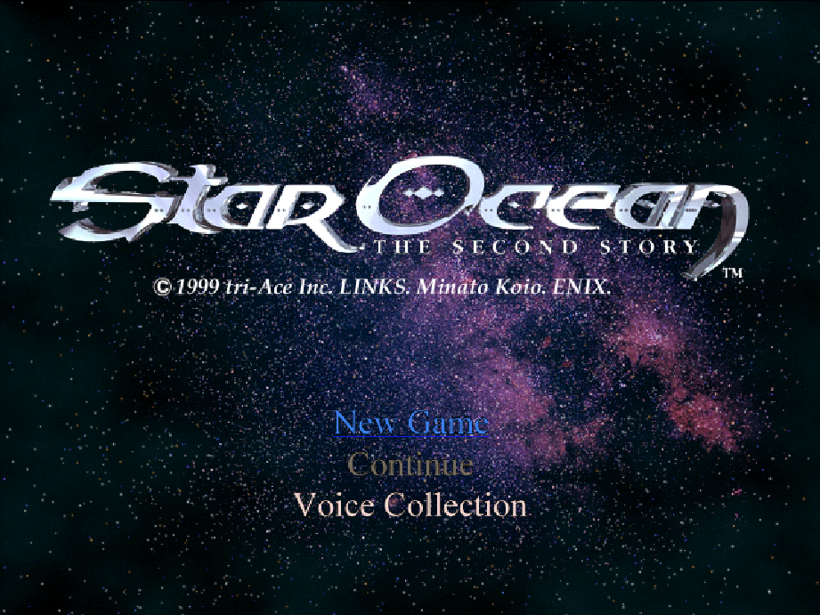
</p>

<p align="center">
  <a href="https://github.com/IronJade/Shattered-Stars/wiki">Wiki</a> ·
  <a href="https://github.com/IronJade/Shattered-Stars/wiki/Installing-and-Setup">Install</a> ·
  <a href="https://github.com/IronJade/Shattered-Stars/wiki/Playing">Play</a> ·
  <a href="https://github.com/IronJade/Shattered-Stars/wiki/Archipelago">Archipelago</a> ·
  <a href="https://github.com/IronJade/Shattered-Stars/wiki/Modding">Modding</a> ·
  <a href="https://github.com/IronJade/Shattered-Stars/wiki/How-the-Port-Was-Made">How it was made</a>
</p>

---

## What it is

Shattered Stars is a native Windows and Linux port of *Star Ocean: The Second Story*, the
PlayStation role-playing game, in its North American, European (English), French and German
releases. The game's code was read from the disassembly, function by function, and rewritten
by hand as ordinary C++20 on top of SDL3 and OpenGL.

- **It is not an emulator.** No PlayStation code runs. The port replaces the console's
  hardware (graphics, geometry, sound, movies, memory cards) with native code, and the game
  itself with a hand-written reimplementation.
- **It ships no game data.** Maps, models, music, voices, text and movies are read from images
  of your own discs while you play. The release packages contain none of them, and the
  repository holds only a few screenshots of the port running, for documentation.
- **It is the whole game.** Both discs, every field map, the world map, all 564 battle
  encounters and all 85 endings. It plays from New Game to the credits.

## Highlights

- **Checked against the original, not by eye.** Each system was compared with the original
  game running in [PCSX-Redux](https://github.com/grumpycoders/pcsx-redux): frames, battle
  random-number draws, unit positions and damage, sound driver calls and save data.
- **Full speed, instant loading.** No slowdown when the screen gets busy, no waiting for the
  disc, and the world map runs at its full frame rate.
- **Bugs fixed, gameplay untouched.** 85 cases in the original's code are documented, each
  with its decision. A bug is fixed only where the fix leaves hit timing, damage, difficulty
  and pacing exactly as they were,
  [measured against the original](#faithful-by-design-bugs-fixed-quirks-kept).
- **Saves that travel.** Memory card images are byte-compatible with the console's. Cards from
  emulators work as they are, and DexDrive saves convert in the setup program.
- **Modern controls and display.** Keyboard or gamepad, every button rebindable, analog walking
  and rumble. Windowed, borderless or exclusive full screen at any size, in the original 4:3
  shape, with optional PlayStation-style dithering and vertical sync.
- **Dialogue at your pace.** Optional instant text and auto-advance (off by default): message
  pages appear at once and move on by themselves after a wait you choose, but never past a
  choice, so the story's long scenes can play hands-free without changing what happens.
- **Archipelago built in.** Play in an [Archipelago](#archipelago) multiworld with the network
  client inside the game. No separate client program is needed.
- **Trackers that follow you.** [Universal Tracker](#trackers) rebuilds your room without your
  YAML, and a PopTracker pack shows the world's own logic on maps and boards. While you play, the
  game tells them which map you're on and how far the story has got, and it draws the pack's maps
  from your own disc.
- **Mods that never touch your discs.** Small, guarded patch files change chests, doors, items,
  shops and enemy stats as the game loads, managed from the setup program ([Mods](#mods-and-the-mod-manager)).
- **A setup program.** Choose and verify your disc images, and set display, sound, controls,
  dialogue, memory cards, mods and Archipelago in one window.

## Screenshots

Every image is the port's own OpenGL output, captured from Shattered Stars running.

<table>
  <tr>
    <td width="33%">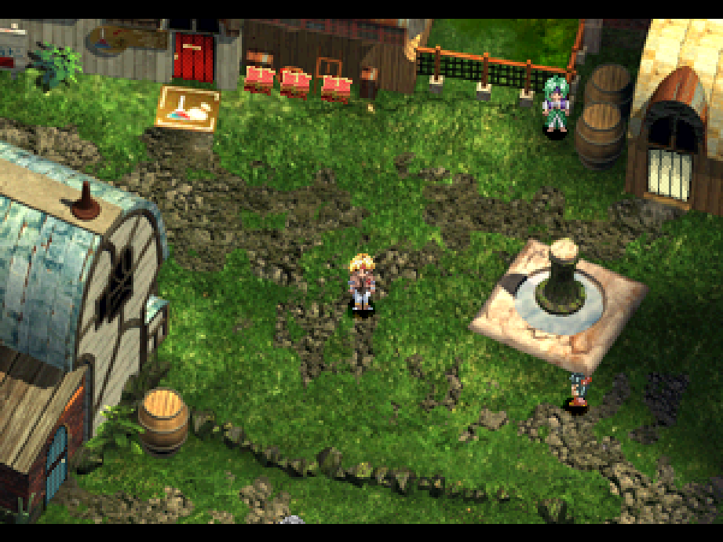<br><sub>Arlia, an early town on Expel</sub></td>
    <td width="33%">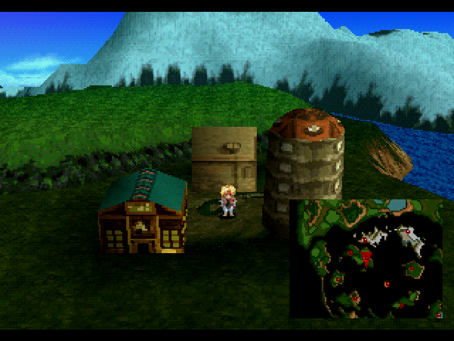<br><sub>The world map</sub></td>
    <td width="33%">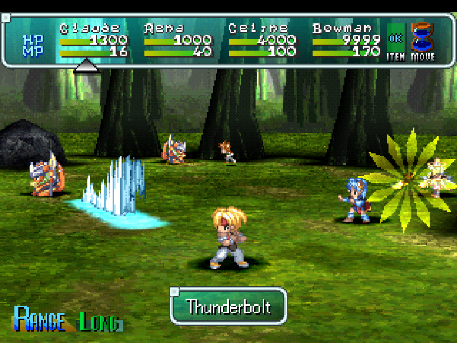<br><sub>Two spells at once in battle (party stats raised for the capture)</sub></td>
  </tr>
  <tr>
    <td>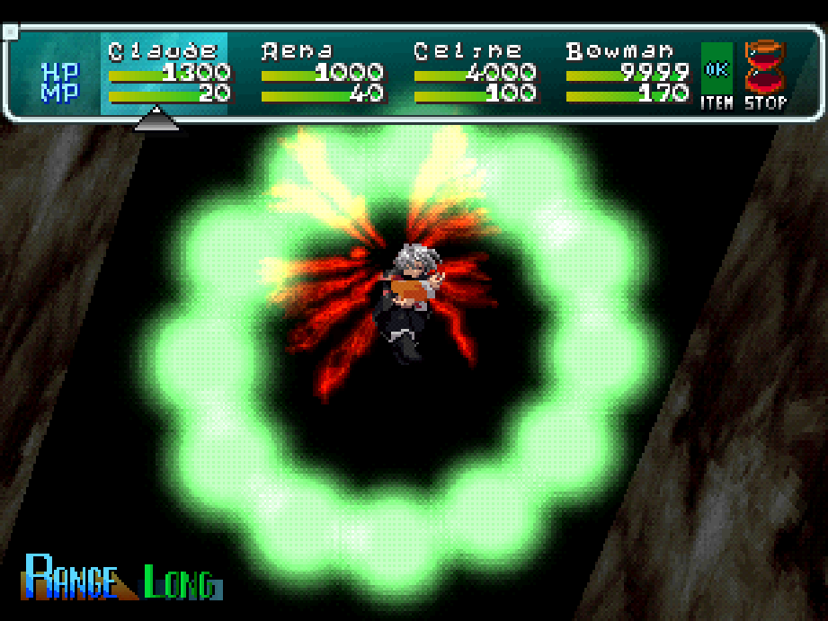<br><sub>A boss battle, mid-cast</sub></td>
    <td>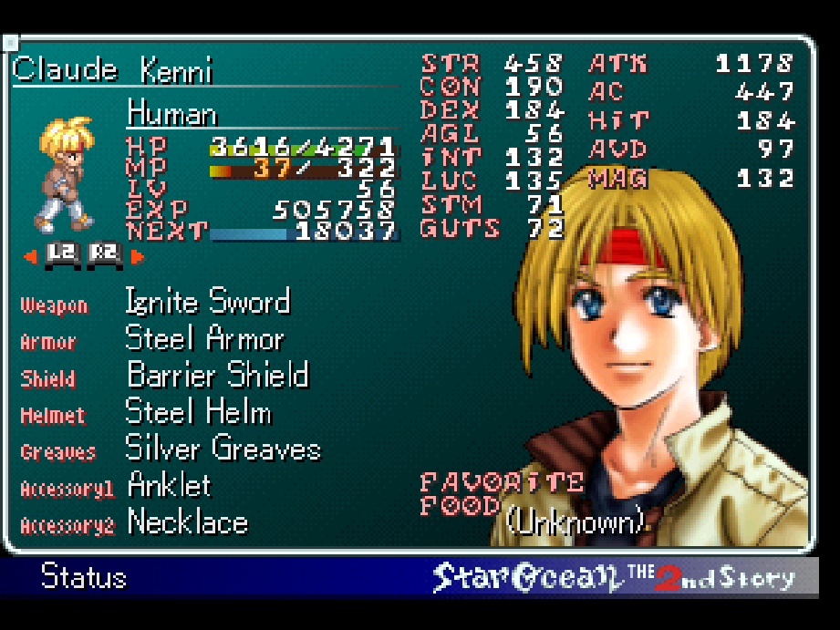<br><sub>The camp menu's Status page</sub></td>
    <td>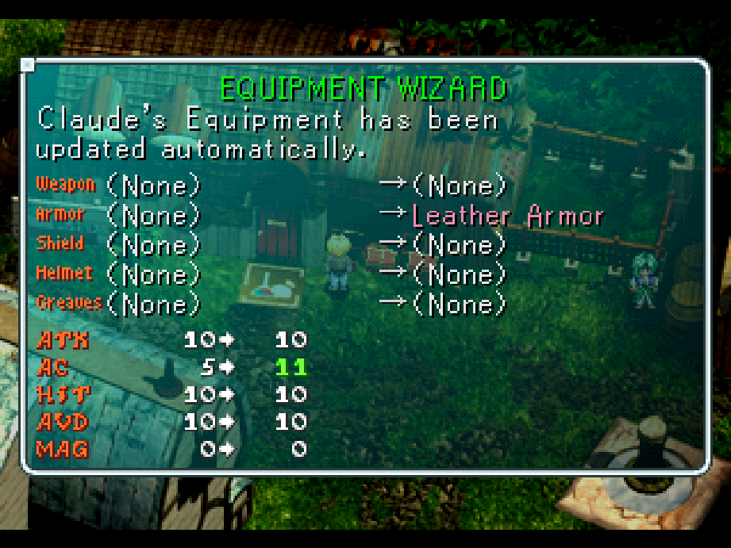<br><sub>The Equipment Wizard</sub></td>
  </tr>
  <tr>
    <td>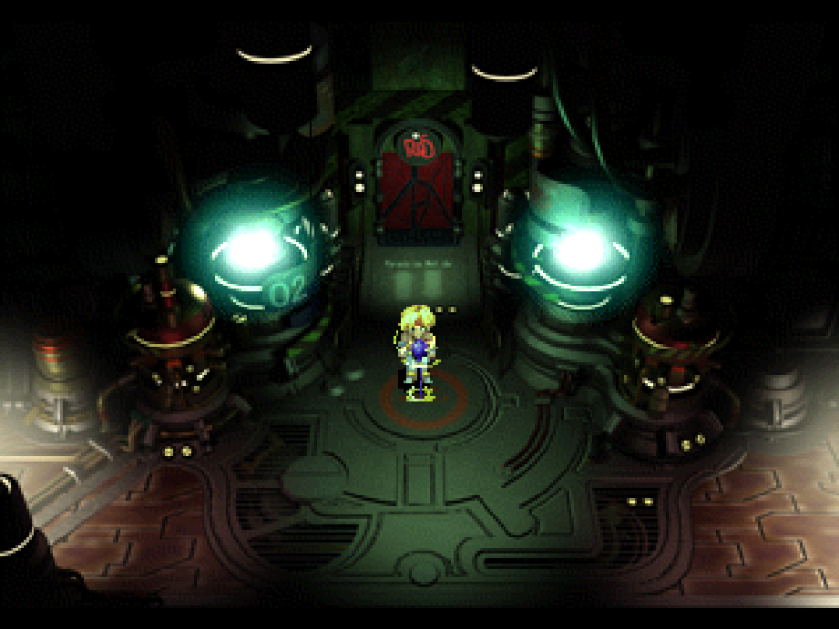<br><sub>Late game: Fienal's Final Save Point</sub></td>
    <td>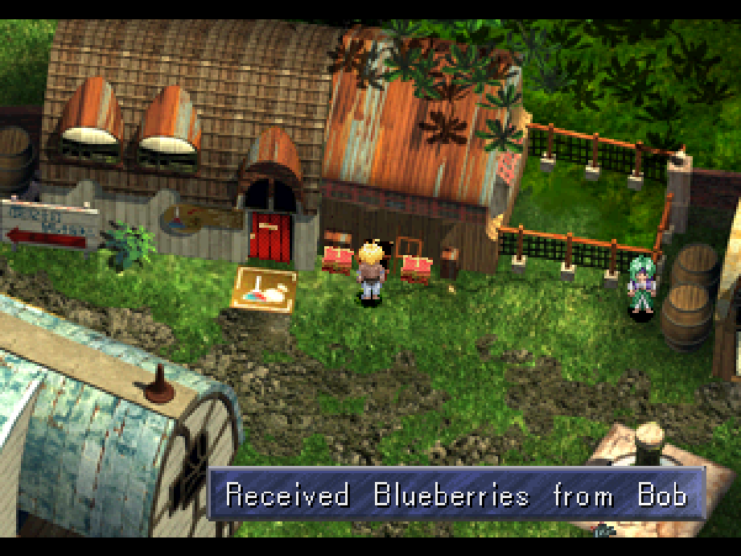<br><sub>Archipelago: an item from another player</sub></td>
    <td>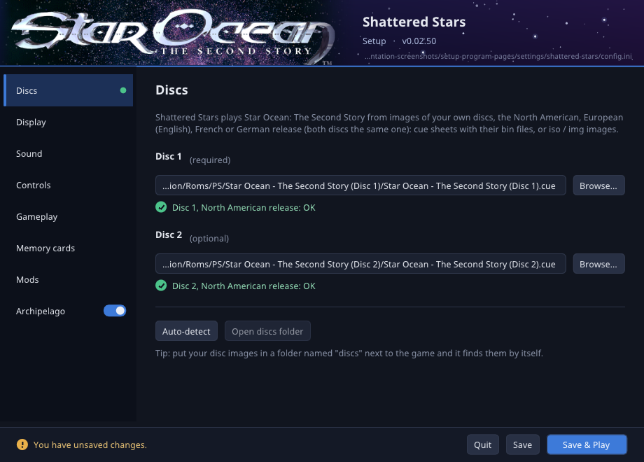<br><sub>Setup: both discs checked</sub></td>
  </tr>
</table>

## Getting started

### What you need

| | |
|---|---|
| **System** | 64-bit Windows, or 64-bit (x86-64) Linux with glibc 2.36 or newer |
| **Graphics** | OpenGL 3.3 |
| **Controls** | A keyboard, or any gamepad SDL recognises |
| **The game** | Images of your own *Star Ocean: The Second Story* discs, from a [supported release](#supported-releases): a `.cue` with its `.bin`, or an `.iso` / `.img` |

Disc 2 is optional until the story asks for it. Compressed formats such as CHD or PBP aren't
accepted yet. There is no macOS build.

### Supported releases

| Release | Disc 1 | Disc 2 | Text |
|---|---|---|---|
| North American | SCUS-94421 | SCUS-94422 | English |
| European | SCES-02159 | SCES-12159 | English |
| French | SCES-02160 | SCES-12160 | French |
| German | SCES-02161 | SCES-12161 | German |

The European, French and German releases are supported from version 0.02.00. They play with
their own text and data on the North American game logic at 60 Hz: the same gameplay, at the
full frame rate. The PAL versions' 50 Hz timing is not reproduced. Saves are kept per release,
as on the console, so a card works with that release's console and emulators. Both discs must
come from the same release; setup shows the release of each disc and refuses a mixed pair.
Japanese discs (SLPM-86105 / SLPM-86106) are recognised but not supported yet.

### Download

Download the [latest release](https://github.com/IronJade/Shattered-Stars/releases/latest) of the game. Each release has two self-contained packages,
with no installer and nothing else to install:

- `ShatteredStars-0.03.00-win64.zip`
- `ShatteredStars-0.03.00-linux-x86_64.tar.gz`

The Archipelago world and the PopTracker pack have releases of their own, apart from the game's:
[so2.apworld 0.2.2](https://github.com/IronJade/Shattered-Stars/releases/tag/apworld-v0.2.2) (see
[Archipelago](#archipelago)) and
[PopTracker pack 1.0.0](https://github.com/IronJade/Shattered-Stars/releases/tag/poptracker-v1.0.0)
(see [Trackers](#trackers)).

### First launch

1. Unpack the package anywhere.
2. Run the setup program: `setup.exe` on Windows, `./shattered-stars-setup` on Linux.
3. On the **Discs** page, choose Disc 1 and Disc 2 with **Browse...**. Or put your images in the
   `discs` folder next to the game and press **Auto-detect**. Setup checks each image and says
   whether it is the right disc.
4. Press **Save & Play**.

After that, start the game directly with `shattered-stars.exe` or `./shattered-stars`. F11 or
Alt+Enter switches between the window and full screen. Esc pauses the game and asks before
quitting (**Keep playing** or **Quit**; unsaved progress is lost on Quit). Settings, memory
cards and mods live in your user folder, so a new version can replace the old one without
touching them.

On Linux, `./install-desktop-entry.sh` (optional, in the package) adds the game and its setup
program to your application menu with their icon, for your user only. GNOME and KDE Plasma on
Wayland show a program's name and icon in the taskbar only once that is installed. Run it
again after moving the folder; `./install-desktop-entry.sh --uninstall` removes it.

The [Installing and Setup](https://github.com/IronJade/Shattered-Stars/wiki/Installing-and-Setup)
and [Playing](https://github.com/IronJade/Shattered-Stars/wiki/Playing) pages cover every setup
page, the controls, saves, the disc change and what differs from the console. Common questions
are answered in the [FAQ](https://github.com/IronJade/Shattered-Stars/wiki/FAQ).

## How it was made

Shattered Stars is a **hand port**. It follows the method of
[Severed Chains](https://github.com/Legend-of-Dragoon-Modding/Severed-Chains), the hand port of
*The Legend of Dragoon*. It doesn't use emulation, and it doesn't machine-translate the game's
code with static recompilation. Every function of the original was read and understood, and
the ones the game needs were rewritten by hand as readable C++, on top of a native replacement
for the PlayStation hardware.

### Written with AI

In the open: most of this repository was written or edited to work by **Claude**, Anthropic's AI model, working
through Claude Code under the direction of the project's maintainer (IronJade). That includes the
reverse engineering and its function catalog, the C++ ports capability to use PAL discs, the setup program, the European,
French and German releases, all of the Archipelago work, and the documentation. The maintainer
chose the project and its goals, made the design decisions, played and tested the port, and
decides each release. Every commit Claude wrote says so with a `Co-Authored-By: Claude` line,
so the history shows which ones. None of it is taken on trust: every function is checked
against the original game running in PCSX-Redux, as described below. The repository's history
starts in October 2026; the maintainer's earlier work on the game is not part of it.

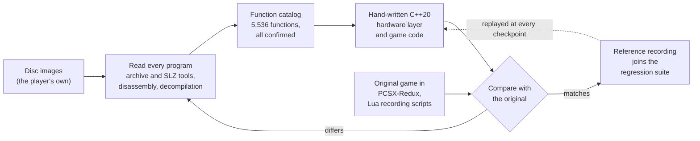

**1. Read every program.** The game is not one executable. The boot program loads further
programs and code overlays from the disc's archive as you play: the title, the field (with its
field-map and world-map overlays), 17 menu overlays, the battle program with 12 overlay
blocks, 12 party-member modules, 40 enemy code blocks carried inside the encounter data, 55
spell modules, and the credits. All of them were disassembled and decompiled, with the
[REA](https://github.com/morluto/rea) reverse-engineering tools and Ghidra. Ghidra's signature matcher identified 406 functions from
Sony's PsyQ SDK, and a function matcher finds code shared between programs linked at different
addresses, so each function only has to be understood once. Project tools read the archive and
its SLZ compression, and disassemble the field event scripts.

**2. Catalog everything.** Every function goes into
[`docs/catalog/functions.csv`](docs/catalog/functions.csv) with its module, address, name,
signature, summary, confidence, evidence and its place in the port. The catalog holds
**5,536 functions across 172 code modules, every one confirmed**. Of those, 4,547 are ported
to C++, 901 aren't needed (dead code, stale copies, or hardware a PC doesn't have) and 88 are
Sony library routines replaced by the port's runtime. A gap scanner searches every program for
call targets the catalog lacks, and finds none. Globals, event-script opcodes and data formats
are catalogued beside it, and [`docs/notes`](docs/notes) explains how each program fits together.

**3. Rewrite it by hand.** The hardware layer came first, each part checked on its own:

| Layer | Checked against |
|---|---|
| Disc archive and SLZ decompression | Byte-identical to the console's output |
| GPU (a software renderer of the PlayStation's video memory) | Hardware video-memory dumps from public PS1 GPU test programs |
| GTE (the geometry coprocessor) and Sony's libgte | Bit-exact with PCSX-Redux and with Sony's own library code |
| MDEC and STR movies | All 23,869 movie frames on both discs, exact against jPSXdec's PlayStation-accurate mode |
| SPU, Sony's libspu and the game's sound driver | Music and effects match PCSX-Redux |
| Memory cards | Save blocks byte for byte, apart from a few bytes the original fills with leftover memory |

The game code sits on top. Names follow the catalog and comments cite the original addresses,
so any line can be traced back to the disassembly. Data stays on the disc: even where an
overlay is native C++, its tables are read from your images at run time. A few differences are
deliberate and documented: loading is instant instead of streamed from a drive, memory pools
are larger, and where the original reads uninitialised memory the port uses a safe value.
Every part of the game can run headless, so tests and sweeps run the real game code at full
speed.

**4. Verify against the original.** The same scene is run with the same input in the port and
in the original under PCSX-Redux, whose Lua scripts record reference frames, sound driver calls
and event-script traces. The comparisons are measured:

- **Random numbers,** the most sensitive test there is. Battles are compared draw by draw, and
  many references are *RNG-equal to the exit*: every draw from the start of the battle to its
  end matches the original.
- **Frames,** compared in the console's 15-bit colour space; the logos and the title screen
  are pixel-identical.
- **Units and effects,** frame by frame: positions, animations, projectiles and damage numbers.
- **Memory and saves,** byte for byte; **sound,** by driver call and by mixed output.

Whole-game sweeps back this up. The event sweep ran every trigger, Private Action, conversation
and pickpocket entry of all 827 field maps on both discs (5,326 entries) without a crash. The
battle sweep ran all 564 encounters headless, including a pass under AddressSanitizer. All 85
ending ids play, and a late-game save was played through the final battle and the endings in
both the port and the original, with the same results.

Every PCSX-Redux recording made along the way is kept in a
[reference regression suite](tools/refs/README.md): 339 recordings, 223 of them replayed
automatically through the port. At the last full run, 219 of those passed, and the rest are
open leads. A quick set of 28 runs at every project checkpoint, beside the three test suites
(`ss_tests`, `ss_game_tests` and a whole-game smoke test).

The full method is on the wiki:
[How the Port Was Made](https://github.com/IronJade/Shattered-Stars/wiki/How-the-Port-Was-Made).

## Faithful by design: bugs fixed, quirks kept

Rewriting the game by hand meant reading every one of its bugs. The rule for them is simple:

> **A fix never changes how the game plays.** Hit timing, the number of hits, damage,
> difficulty and battle pacing stay the original's. This is measured against the original,
> not judged by eye.

- **Measure first.** Before a fix goes in, the faithful version is compared with the original
  in PCSX-Redux: the frames hits land on, the hits, the damage, the waits and the random
  numbers. The fix goes in only if those stay the same. Otherwise it is **held**, and the
  numbers go to the maintainer to decide.
- **Visual fixes are fine.** Where one needs randomness, it draws from a separate, looks-only
  random source, so the game's own random sequence is untouched.
- **Crashes are avoided.** Where the original reads or writes memory it shouldn't, and only got
  away with it on a console by luck, the port does something safe. Up to that point it plays
  exactly the same.
- **Saves stay byte-compatible,** leftover bytes included, so cards work in both directions.
- **Nothing is hidden.** In the source, the original line is kept as a comment marked
  `ORIGINAL BUG (original_bugs.md <id>)`, with the corrected code below it, and every case is
  listed in [`docs/notes/original_bugs.md`](docs/notes/original_bugs.md).

Slowdown is not modelled either: the original drops frames under heavy load, and the port
always runs at full speed.

| Fixed | Avoided | Kept: intended | Kept: gameplay | Held | Not fixed yet | Not a bug | **Total** |
|---:|---:|---:|---:|---:|---:|---:|---:|
| 44 | 20 | 8 | 4 | 6 | 2 | 1 | **85** |

Some examples from each class:

| Status | The bug | What the port does, and why |
|---|---|---|
| **Fixed** | Renaming Claude compared the new name with "Crawd" (the Japanese release's spelling), so keeping the name "Claude" switched his battle voices to the lines that avoid saying it | The check uses "Claude", as the title screen's naming already did |
| **Fixed** | On the mine-cart stage, the damage number said 50 while the cart lost 100 HP | The number shows the 100 actually taken. The damage itself was already right |
| **Fixed** | One enemy's attack could reach a step no code handles, freezing it in place | A block or a landing moves it on |
| **Fixed** | A conversation that ends by removing the character you spoke to kept using that character after freeing it, then freed it twice. Harmless on the console only by luck; the port crashed there | The step stops once the character is gone |
| **Avoided** | A spell projectile meeting five or more enemies at once overruns its four-entry lists, likely a crash on the console | The lists hold eight. With up to four, it plays exactly as on the console |
| **Kept: intended** | Shigeo's chance test always passes | He is meant to be unbeatable in the first fight |
| **Kept: gameplay** | In one of Opera's killer moves, the last shard drops from the burst point instead of flying straight up | With the fix, the move's two hits land 8 and 19 frames earlier |
| **Kept: gameplay** | When a party member first jumps at a flying enemy depends on whatever the stage file left in memory | Reproduced exactly: the port works out the value the console would read, so the jump starts on the same frame |
| **Held** | The Gremlin Lair spell never advances its own timer, so its pauses don't pause | The fix would make the spell 42 frames longer and shift every later random roll |

Held fixes exist but are off. Some can be switched on for testing with the `SS_HELD_FIXES`
environment variable (for example `SS_HELD_FIXES=S17`); that changes gameplay, so it isn't for
normal play.

Every case, with its reason, is on the wiki:
[Bugs Fixed and Quirks Kept](https://github.com/IronJade/Shattered-Stars/wiki/Bugs-Fixed-and-Quirks-Kept).

## Mods and the mod manager

Mods change the game's data in memory as it loads. Your disc images are never modified. A mod
is data, never code: lines of text in a small patch format that can change:

| What | For example |
|---|---|
| Chests | What a chest gives: another item, or an amount of Fol |
| Doors | Where a door or map exit leads |
| Items | Price, attack, defence, effect, type, sell value |
| Shops | What a shop sells: replace, remove or add an item |
| Enemies | HP, MP, EXP, Fol, speed, drops and their odds, attack, defence, level and more |

**Every change is guarded.** Each line carries the value your disc holds as well as the new
one, and the change is made only while the original value is still there. A line written for
different data is skipped and logged instead of corrupting anything. `tools/so2_mod.py` reads
your own disc and writes the lines for you, so the expected values always come from the disc.
Mods apply to every supported release: the lines name places as they are on the North American
disc, the game translates them for the disc you play, and a line whose data differs in that
release is skipped.
This line, from one of the sample mods, turns a 200 Fol crate in Arlia into 500 Fol:

```text
# map 18 chest 0x962: 200 Fol -> 500 Fol
script 18 0x82c 0xffffff38 0xfffffe0c
```

**The mod manager.** Mods come as packages: a folder, or a `.zip` of one, holding a `mod.json`
manifest (name, version, author, description, the oldest port version it works with) and its
patch files. The setup program's **Mods** page installs them from a `.zip`, turns each on or
off, sets the load order, removes them, and shows each mod's description and README. When two
enabled mods change the same thing, the later one in the load order wins, and setup warns you
and says which. Loose `.patch` files keep working as before, and an Archipelago seed's own
edits always apply first and are never overridden by a mod.

<p align="center">
  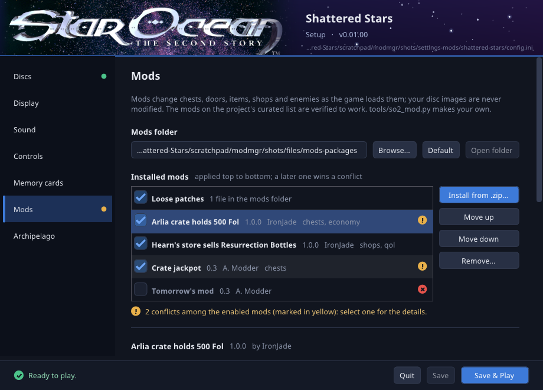
</p>

**The curated list.** The [`mods/`](mods) folder of this repository holds the curated mod list;
today it has two small sample packages. Creators submit a mod as a pull request. An automatic
check runs on every submission (`tools/mod_check.py --strict`, no discs needed): it checks the
package's files and every patch line against the disc's tables, and fails unless each risky
edit (a door sent elsewhere, a free item, a boss with 0 HP, ...) is declared with a reason.
Then the maintainer runs the mod in the real game with `tools/mod_verify.py`: every patch line
must apply, and every map and battle the mod touches must load and run as it does without the
mod. Only then is it marked verified, and any later change to its files clears that.

On the wiki: [Installing and Managing Mods](https://github.com/IronJade/Shattered-Stars/wiki/Installing-and-Managing-Mods),
[Making a Mod](https://github.com/IronJade/Shattered-Stars/wiki/Making-a-Mod),
[Submitting a Mod](https://github.com/IronJade/Shattered-Stars/wiki/Submitting-a-Mod), and the
[Modding](https://github.com/IronJade/Shattered-Stars/wiki/Modding) overview.

## Archipelago

[Archipelago](https://archipelago.gg) is a multiworld randomizer: several players, each in
their own game, have the items of all their games shuffled together, and an item found for
someone else is sent to them over the network. Shattered Stars has the Archipelago client
built into the game.

<p align="center">
  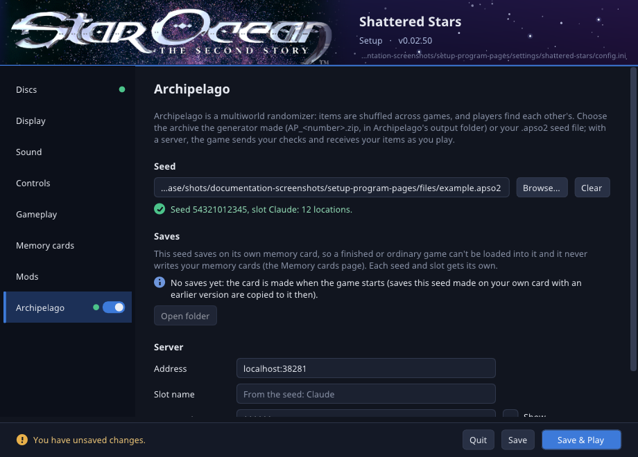
</p>

**What is randomised.** Every chest (308) and every gift site (101: a scene, a Private Action
or a prize table that hands you an item or Fol) always holds an item from the multiworld. The
story's key items are never shuffled, so the story always carries on. Optionally, more
locations join in: defeating bosses (41, on by default), party members joining you (they become
items), the first drop of each enemy type (89), shop slots (up to 550), the first creation of
each item with Item Creation (553), killer-move proficiency levels (133), and skills, killer
moves and spells, whose guild purchases and learn points become checks. Traps, EXP and Fol
multipliers, the encounter rate, the Battle Rank and the post-game Cave of Trials are options
too.

**Three ways to play.** The story mode follows the story as it is. The open world locks the
world map's entrances behind 35 area keys and, with character items, builds your party from the
members you receive. The hub mode starts after the Final Save Point with both worlds open: each
dungeon opens with its key, each story boss waits in its chamber, and Fienal opens once the
bosses are beaten.

**A party of twelve.** In open world with character items and in hub mode, every member you
haven't excluded can join: besides the game's eight places, a bench keeps four more, and the
camp menu's Party Order swaps anyone but the hero between the party and the bench. A starting
character other than the hero leads from the party's first place.

**The hell seed.** No random battles, with killer-move levels or learn points as checks: all
the training happens in Fun City's arena, which such a seed makes free. Setup warns you when
you choose one.

**The goal** is defeating Indalecio, the final boss, in Fienal: as he is, with his limiter off,
or with his limiter off and the Iseria Queen beaten too.

**DeathLink** is optional: a real Game Over sends a death to the other DeathLink players, and a
death received from them knocks out your party at the next safe moment.

**How to play:**

1. Copy `so2.apworld` into the `custom_worlds` folder of Archipelago 0.6.8 or newer, and set
   your options in a YAML file, starting from the template.
2. Generate the multiworld as usual. Archipelago writes `AP_<number>.zip` into its `output`
   folder; each Star Ocean player's seed (`.apso2`) is inside it.
3. In the setup program's **Archipelago** page, choose that archive (Browse starts in
   Archipelago's `output` folder; no need to unpack it) or a loose `.apso2`, pick your slot if
   the archive holds several Star Ocean players, and enter the room's address, your slot name
   and the password. Press **Save & Play**; the game connects as it starts. Each seed saves on
   its own memory card, so your ordinary saves and the seed's never mix. The switch beside
   **Archipelago** in setup's sidebar turns it off again: the original game, with the seed kept
   for later.

To play a seed on your own, leave the address empty: your locations are still shuffled and
checked, and items from your own world are given to you. One seed works with the discs of any
supported release.

This is a custom world, not yet part of Archipelago itself, so it has releases of its own,
apart from the game's: download `so2.apworld` and its YAML template
(`Star.Ocean.The.Second.Story.yaml`) from [so2.apworld 0.2.2](https://github.com/IronJade/Shattered-Stars/releases/tag/apworld-v0.2.2), or build them with
`tools/build_apworld.sh`. A seed made with the bench needs Shattered Stars 0.02.51 or later. Every
option, the fights you can't win, and troubleshooting are on the
[Archipelago](https://github.com/IronJade/Shattered-Stars/wiki/Archipelago) page.

### Trackers

Two popular Archipelago trackers work with this world. They connect to your room next to the
game, and show what you have received and checked as the server knows it.

- **[Universal Tracker](https://github.com/FarisTheAncient/Archipelago/releases)** lists the
  locations you can reach now, by the world's own logic. With so2.apworld 0.2.2 it needs no YAML:
  it rebuilds your room from the room's own data, and `/explain <location>` says what a location
  needs.
- **The PopTracker pack** (`so2_shattered_stars`, from
  [its own release](https://github.com/IronJade/Shattered-Stars/releases/tag/poptracker-v1.0.0))
  shows every check on maps and boards, green when it is in logic and red when not, from the logic
  the room carries. It updates itself through PopTracker.
- **They follow your game.** While it is connected (Shattered Stars 0.03.00), the game keeps the
  map you're on and the story's chapter in the server's data storage: PopTracker's tabs switch to
  your map, and in story mode both trackers show only what the story has reached (PopTracker shows
  the rest in blue).
- **Maps from your own disc.** The pack ships only plain stand-in maps. The setup program's
  **Render tracker maps for PopTracker** button (or `shattered-stars --render-tracker-maps`) draws
  every area, every room and both world maps from your disc 1 into PopTracker's override folder for
  the pack, so nothing from the game is ever published.

Setup and troubleshooting: [Trackers](https://github.com/IronJade/Shattered-Stars/wiki/Trackers)
on the wiki.

## Building from source

You need CMake 3.24 or newer, a C++20 compiler and, ideally, the SDL3 development files (without
them the build downloads and builds a pinned SDL 3). OpenSSL and zlib development files are
optional, for `wss://` Archipelago servers and compression.

```sh
git clone https://github.com/IronJade/Shattered-Stars.git
cd Shattered-Stars
cmake -S engine -B engine/build -G Ninja
cmake --build engine/build

engine/build/shattered-stars-setup     # choose your disc images
engine/build/shattered-stars           # play

# Tests (the disc tests need your Disc 1 image)
SS_DISC1=".../Disc 1.cue" engine/build/ss_tests
SS_DISC1=".../Disc 1.cue" engine/build/ss_game_tests
SS_DISC1=".../Disc 1.cue" tools/smoke_field_events.sh engine/build/shattered-stars
```

Release packages are built with `tools/build_linux.sh --container` (in a pinned Debian 12
container, for glibc 2.36 and newer) and `tools/build_windows.sh` (cross-compiled with
MinGW-w64), the world with `tools/build_apworld.sh` and the PopTracker pack with
`tools/build_poptracker.sh all`. Details, build options and the `.apworld` build are on
[Building from Source](https://github.com/IronJade/Shattered-Stars/wiki/Building-from-Source).

## Project layout

```text
apworld/so2/   The Archipelago world (Python): locations, items, logic, options and tests
docs/
  catalog/     The reverse-engineering catalog: every function, global, script opcode and format
  notes/       How each program works, the original's bugs, accuracy and audit notes
  ap/          The Archipelago seed format and the world's logic
  images/      The screenshots used here and on the wiki
engine/
  src/         The C++20 source: hardware replacements, ported game code, setup, Archipelago client
  tests/       Unit, disc and game tests
mods/          The curated mod list
res/           The application icon (an original design drawn by tools/make_icon.py), the Windows
               resource and manifest templates, the Linux .desktop files
tools/         Disc, script and mod tools, comparison scripts, sweeps, packaging, the reference suite,
               the PopTracker pack's generator (tools/ap_poptracker.py, its Lua in tools/poptracker/)
```

## Contributing

Bug reports and fixes are welcome. Please read
[Contributing](https://github.com/IronJade/Shattered-Stars/wiki/Contributing) first; bugs go to
the [issue tracker](https://github.com/IronJade/Shattered-Stars/issues).

A fix to gameplay code follows the play-state rule. Measure the faithful version against the
original in PCSX-Redux first, and keep the fix only if hit timing, hits, damage and pacing stay
the same. Keep the original line visible as an `ORIGINAL BUG` comment, add its row to
[`docs/notes/original_bugs.md`](docs/notes/original_bugs.md), and run the three test suites
headless before opening a pull request. No game code or data may ever be committed.

## Legal

Shattered Stars contains none of *Star Ocean: The Second Story*'s program files or data: the
port's code is an independent reimplementation, and its release packages include no graphics,
sound, text or other game files. To play, you need
your own, legally obtained copy of the game's discs; nothing can be downloaded here.

This project is not affiliated with or endorsed by Square Enix, tri-Ace or Sony Interactive
Entertainment. *Star Ocean* is a trademark of Square Enix. PlayStation is a trademark of Sony
Interactive Entertainment. The screenshots in [`docs/images`](docs/images) show the port
running and are included for documentation only.

## Licence and acknowledgements

Shattered Stars' own code is released under the [MIT licence](LICENSE). Third-party components
keep their own licences; the release packages list them in `THIRD-PARTY-LICENSES.txt`.

**Built with**

- [SDL 3](https://libsdl.org): window, input, gamepads and audio
- [Dear ImGui](https://github.com/ocornut/imgui): the setup program's interface
- [apclientpp](https://github.com/black-sliver/apclientpp), [wswrap](https://github.com/black-sliver/wswrap),
  [WebSocket++](https://github.com/zaphoyd/websocketpp), [Asio](https://github.com/chriskohlhoff/asio)
  and [JSON for Modern C++](https://github.com/nlohmann/json): the Archipelago client
- [OpenSSL](https://www.openssl.org) and [zlib](https://zlib.net): secure connections and
  compression for the Archipelago client

**Made possible by**

- [Claude](https://www.anthropic.com/claude) by Anthropic, through
  [Claude Code](https://claude.com/claude-code): the AI that wrote most of the code, the
  reverse-engineering notes and the documentation with the maintainer
  (see [Written with AI](#written-with-ai))
- [PCSX-Redux](https://github.com/grumpycoders/pcsx-redux), the reference every system was
  measured against
- [Archipelago](https://archipelago.gg), the multiworld framework
- [Severed Chains](https://github.com/Legend-of-Dragoon-Modding/Severed-Chains), whose hand-port
  method this project follows
- [REA](https://github.com/morluto/rea), the reverse-engineering toolkit used for disassembly,
  decompilation and analysis
- [Ghidra](https://github.com/NationalSecurityAgency/ghidra), for decompilation and its PsyQ
  signature matching
- [jPSXdec](https://github.com/m35/jpsxdec), the reference for the movie decoder
- [ps1-tests](https://github.com/JaCzekanski/ps1-tests), whose hardware video-memory dumps check
  the GPU
- [psx-spx](https://psx-spx.consoledev.net), the PlayStation hardware reference
